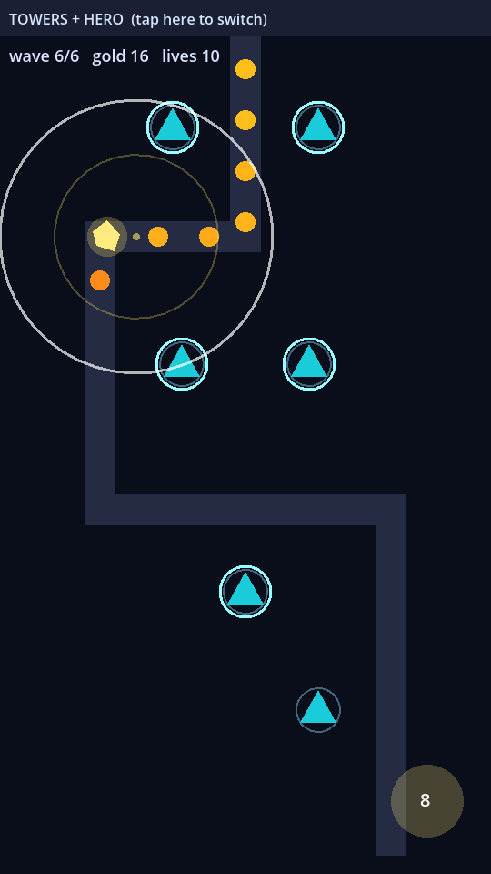

# TowerRiot

A portrait, one-thumb tower defense for iOS and Android. Towers hold the ground, and one hero decides the fight: drag it to pin it to the lane that is leaking, then drag from the burst button to aim into the bunched wave.

> **Status: pre-production.** There is no game build yet. This repo holds two throwaway prototypes and the design documents. Production code has not started.

<p align="center">
  
</p>
<p align="center"><em>The hero-pin prototype at wave 6, played by its test bot. Placeholder art; desktop capture.</em></p>

## The idea

- **Towers and tower upgrades** on fixed build slots along a lane.
- **One hero you position, not steer.** It holds its pin and fights only inside a leash.
- **An aimed burst** as the hero's signature moment.
- **Three skill trees** (towers, tower weapons, hero) that cross-buff, so builds differ. Planned, not built.
- **20 stages** whose paths and attacks change. Planned; the prototypes have one.

## Try the prototype

Requires [Godot 4.7.2](https://godotengine.org/download).

```
godot --path prototypes/hero-pin-concept
```

| Action | Input |
|---|---|
| Build a tower, upgrade it | Tap a slot, tap it again |
| Pin the hero | Drag from the hero |
| Aim the burst | Drag from the round button |
| Switch test mode | Tap the top strip, or keys 1 to 4 |

To run the headless bot comparison of all four modes:

```
godot --headless --path prototypes/hero-pin-concept -- --auto
```

## What the prototypes found

The first prototype used tap-to-move, and the hero felt like a chore. The second replaced it with pin and aim, and the tester preferred it.

| Mode (bot, second prototype) | Result |
|---|---|
| Towers + hero, driven | Won, 10/10 lives |
| Towers only | Won, 3/10 lives |
| Hero only | Lost at wave 4 |
| Towers + hero, never touched | Won, 3/10 lives |

This is thin evidence: one tester, who is also the designer, using a mouse. The bot's numbers are not balance values, and the controls have never been played on a phone. Details are in [the hero-pin report](prototypes/hero-pin-concept/REPORT.md).

## Documents

| Document | State |
|---|---|
| [Game concept](design/gdd/game-concept.md) | Approved |
| [Systems index](design/gdd/systems-index.md) | Draft: 22 systems, 8 in the MVP |
| [Art bible](design/art/art-bible.md) | Revised; device checks pending |
| [Data & Config Pipeline](design/gdd/data-config-pipeline.md) | Designed, awaiting independent review |
| [Prototype index](prototypes/index.md) | Two prototypes: PIVOT, then PROCEED |

The next steps are the remaining 7 MVP design documents, then architecture and the MVP build.

## Tech

Godot 4.7.2, GDScript and the Mobile renderer. Tests use gdUnit4 6.2.0 under `addons/`; no game tests exist yet, so a green CI run proves nothing so far.

## Built with

This project started from [Claude Code Game Studios](https://github.com/Donchitos/Claude-Code-Game-Studios), a set of Claude Code agents and skills for game development. Its files in `.claude/` are used under the [MIT License](LICENSE). Its original manual is in this repo's git history.
